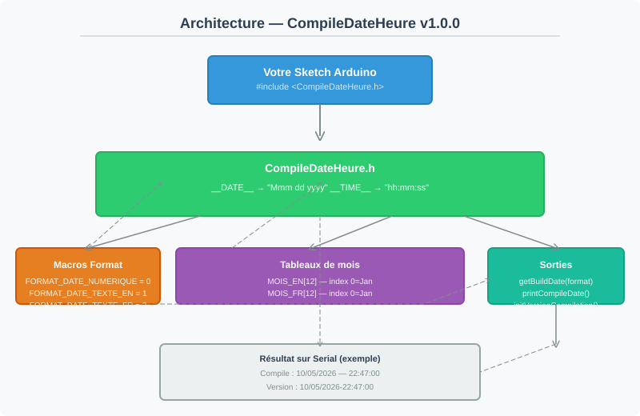

# CompileDateHeure

[](https://www.gnu.org/licenses/gpl-3.0)
[](https://docs.arduino.cc/software/ide/)
[](https://platformio.org/)
[](https://platformio.org/)
[](https://github.com/Fo170/CompileDateHeure)

**Auteur :** FOURNET Olivier — olivier.fournet@free.fr  
**Version :** 1.1.1  
**Licence :** GNU General Public License v3.0

---

Librairie Arduino permettant d'afficher la **date et l'heure de compilation** dans le moniteur série.  
Fonctionne sur **ESP8266**, **ESP32** et toute carte compatible Arduino IDE ou PlatformIO.

---

## Sommaire

1. [Installation](#installation)
2. [Utilisation rapide](#utilisation-rapide)
3. [Fonctions de l'API](#fonctions-de-lapi)
4. [NUM_VERSION](#num_version)
5. [Constantes de format](#constantes-de-format)
6. [Exemple complet](#exemple-complet)
7. [Architecture](#architecture)
8. [Compatibilité](#compatibilité)
9. [License](#license)

---

## Installation

### Arduino IDE

1. Téléchargez le dépôt ZIP : [Code → Download ZIP](https://github.com/Fo170/CompileDateHeure/archive/refs/heads/main.zip)
2. Dans l'IDE Arduino : **Croquis → Inclure une bibliothèque → Ajouter la bibliothèque .ZIP…**
3. Sélectionnez le fichier ZIP extrait

### PlatformIO

Ajoutez dans votre `platformio.ini` :

```ini
[env:esp32dev]
platform = espressif32
board = esp32dev
framework = arduino
lib_deps =
    https://github.com/Fo170/CompileDateHeure.git@^1.1.1
```

Ou dans un projet local, placez le dossier `CompileDateHeure/` dans `lib/`.

---

## Utilisation rapide

```cpp
#include <CompileDateHeure.h>

void setup() {
    initVersionCompilation(FORMAT_DATE_NUMERIQUE);
    Serial.begin(9600);
    Serial.println(s_versionCompilation);
}

void loop() {
}
```

---

## Fonctions de l'API

### `getBuildDate(int format)`

Retourne un `String` contenant la date formatée.

| Paramètre `format` | Valeur | Résultat |
|---|---|---|
| `FORMAT_DATE_NUMERIQUE` | `0` | `"10/05/2026"` |
| `FORMAT_DATE_TEXTE_EN` | `1` | `"10/May/2026"` |
| `FORMAT_DATE_TEXTE_FR` | `2` | `"10/Mai/2026"` |

### `initVersionCompilation(int format)`

Initialise la variable globale `s_versionCompilation` avec la date et l'heure au format `"dd/mm/yyyy-hh:mm:ss"`.

```cpp
initVersionCompilation(FORMAT_DATE_NUMERIQUE);
Serial.println(s_versionCompilation);
// → 11/05/2026-18:00:00
```

---

## NUM_VERSION

Identifiant **numérique** du build, dérivé de la date et de l'heure de compilation.
Encodage `X.Y.Z` compacté dans un seul entier `uint32_t` :

```
NUM_VERSION = X * 10^7 + Y * 10^4 + Z
```

| Champ | Signification | Plage | Chiffres |
|---|---|---|---|
| `X` | année de compilation − 2020 | 0..429 (2020..2449) | 2 |
| `Y` | numéro du jour dans l'année | 1..366 | 3 |
| `Z` | minute du jour (`hh × 60 + mm`) | 0..1439 | 4 |

### Fonctions

| Fonction | Retour | Effet |
|---|---|---|
| `getNumVersion()` | `uint32_t` | Calcule, ne touche pas les globales |
| `getNumVersionTexte()` | `String` | Calcule, ne touche pas les globales |
| `initNumVersion()` | `uint32_t` | Remplit les deux globales et retourne la valeur |

### Variables globales

| Variable | Type | Contenu |
|---|---|---|
| `s_numVersion` | `uint32_t` | `63001093` — pour les comparaisons numériques |
| `s_numVersionTexte` | `String` | `"06.300.1093"` — pour l'affichage |

### Exemples de valeurs

| Date de compilation | `s_numVersion` | `s_numVersionTexte` |
|---|---|---|
| 01/01/2020 00:00 | `10000` | `00.001.0000` |
| 29/02/2024 12:00 | `40600720` | `04.060.0720` |
| 27/10/2026 18:13 | `63001093` | `06.300.1093` |
| 31/12/2026 23:59 | `63651439` | `06.365.1439` |
| 01/01/2030 00:00 | `100010000` | `10.001.0000` |

### Utilisation

```cpp
#include <CompileDateHeure.h>

void setup() {
    Serial.begin(9600);

    initNumVersion();
    Serial.println(s_numVersion);       // 63001093
    Serial.println(s_numVersionTexte);  // 06.300.1093

    // Comparaison numérique : ce build est-il plus récent qu'un seuil ?
    if (s_numVersion > 63000000UL) {
        Serial.println("Build posterieur au 27/10/2026 00:00");
    }
}
```

### Limites à connaître

- **Granularité : la minute.** Deux compilations dans la même minute produisent la même valeur. Les secondes sont **tronquées**, jamais arrondies.
- **Base 2020.** Une date de compilation antérieure au 1er janvier 2020 renvoie `0` et une chaîne vide — jamais de bouclage `uint32_t`.
- **Heure locale du poste de build.** `__DATE__` / `__TIME__` ne sont pas en UTC : deux machines dans des fuseaux différents produisent des valeurs différentes pour le même commit.
- La constante `NUM_VERSION_ANNEE_BASE` (2020) est exposée dans l'en-tête.

---

## Constantes de format

| Constante | Valeur | Description |
|---|---|---|
| `FORMAT_DATE_NUMERIQUE` | `0` | Numérique : `dd/mm/yyyy` |
| `FORMAT_DATE_TEXTE_EN` | `1` | Anglais : `dd/Mmm/yyyy` |
| `FORMAT_DATE_TEXTE_FR` | `2` | Français : `dd/Mmm_fr/yyyy` |

---

## Exemple complet

```cpp
#include <CompileDateHeure.h>

void setup() {
    Serial.begin(9600);
    delay(1000);

    // Variable de version
    initVersionCompilation(FORMAT_DATE_NUMERIQUE);
    Serial.print("Version : ");
    Serial.println(s_versionCompilation);

    // Format texte anglais
    Serial.print("EN : ");
    Serial.println(getBuildDate(FORMAT_DATE_TEXTE_EN));

    // Format texte français
    Serial.print("FR : ");
    Serial.println(getBuildDate(FORMAT_DATE_TEXTE_FR));

    // Identifiant numérique de build
    initNumVersion();
    Serial.print("NUM_VERSION : ");
    Serial.println(s_numVersion);
    Serial.print("NUM_VERSION : ");
    Serial.println(s_numVersionTexte);
}

void loop() {
}
```

---

## Architecture



Le schéma ci-dessus montre le flux :

1. Le **preprocesseur C/C++** injecte automatiquement `__DATE__` et `__TIME__` à la compilation
2. `CompileDateHeure.h` convertit ces macros en chaînes formatées via `getBuildDate()`
3. la variable : `s_versionCompilation` , les applications peuvent utiliser cette valeurs pour l'affichage

---

## Compatibilité

| Plateforme | Support | Notes |
|---|---|---|
| ESP32 | ✅ | Via PlatformIO ou Arduino IDE |
| ESP8266 | ✅ | Via PlatformIO ou Arduino IDE |
| AVR (Arduino Uno, etc.) | ✅ | Toute carte avec Arduino framework |
| Clang/GCC | ✅ | Utilise les macros standard `__DATE__` / `__TIME__` |

**Dépendances :** `Arduino.h` uniquement (inclus automatiquement par l'IDE).

---

## License

Ce projet est distribué sous licence **GNU General Public License v3.0**.  
Voir le fichier [LICENSE](LICENSE) pour les détails complets.

---

*Dernière mise à jour : 2026-10-27*